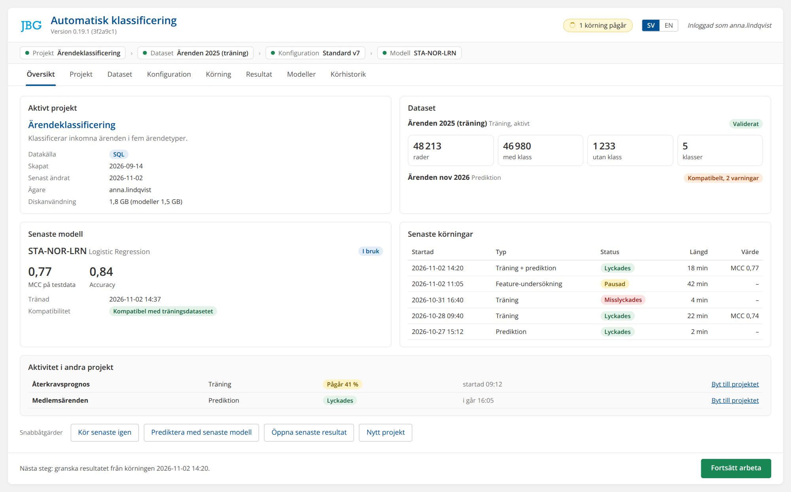
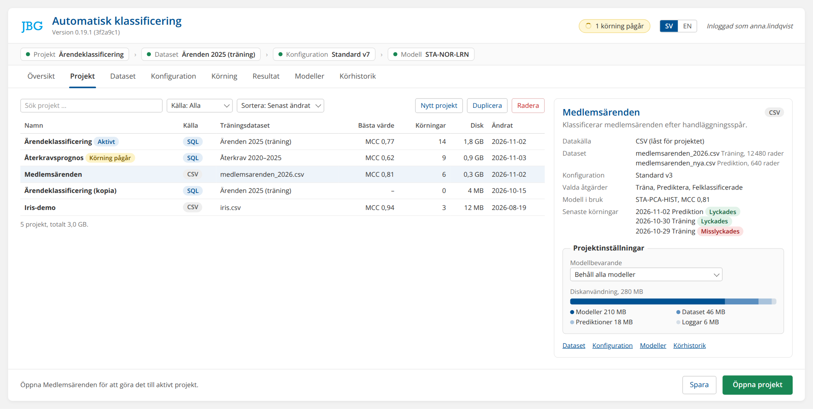
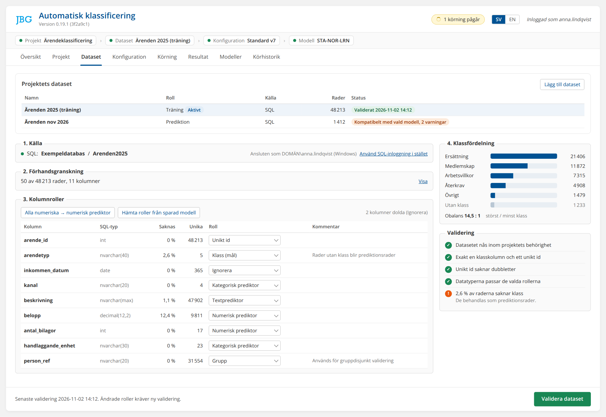
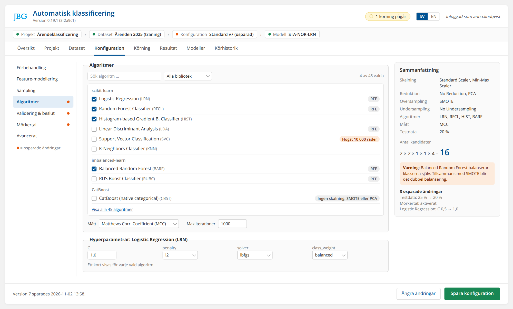
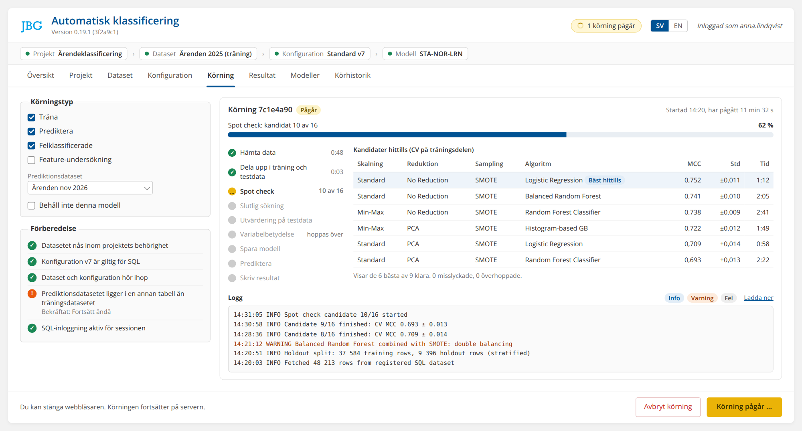
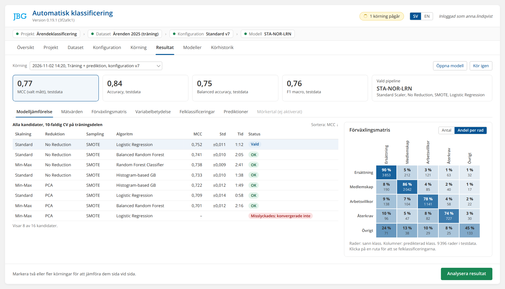
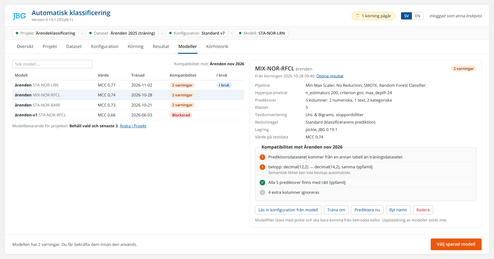
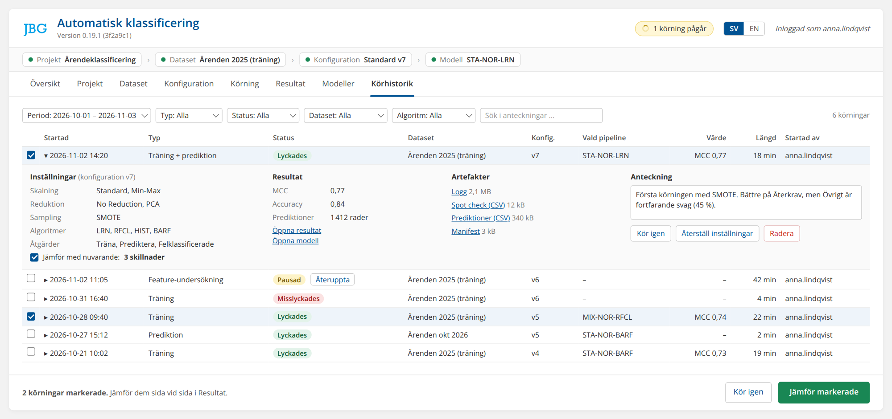
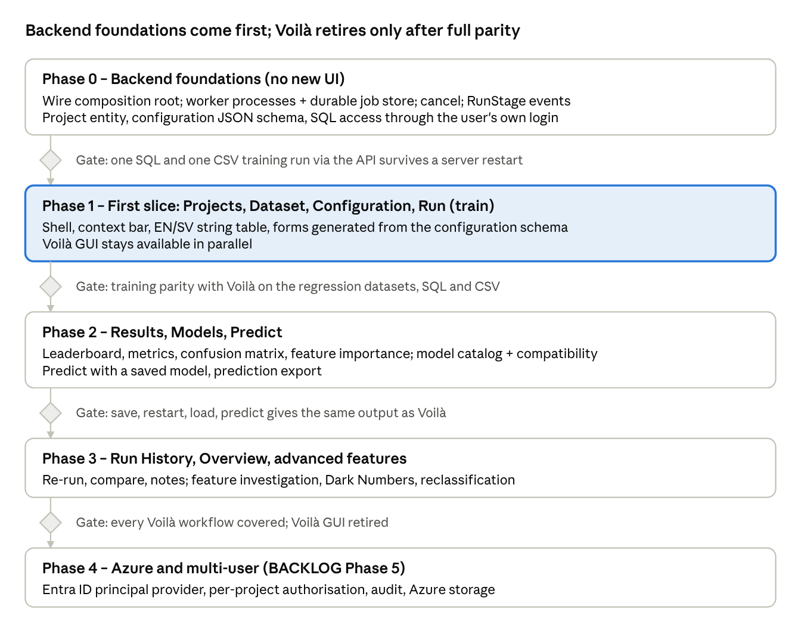

# JBG AutoClassification – Web GUI Design Outline

Status: **locked design**, agreed 2026-11-03 (revision 283a). This document is the binding reference for the new web GUI (BACKLOG Phase 4). The mockups use fictional projects, datasets, users and figures; their HTML sources are in [`mockups/html/`](mockups/html/).

## Purpose and principles

The new GUI replaces the single-page Voilà notebook (`JBG_SML_GUI.ipynb` + `GUI/Widgets.py`, ~5,200 lines) with an eight-tab HTML/CSS/JS client over FastAPI. It follows BACKLOG Phase 4: FastAPI is only an HTTP adapter over the GUI-independent service layer (`JBGRun*Service`, `DatasetApplicationService`), never a home for ML rules.

Design principles, each traced to a constraint already in the code:

- **Server owns identity and scope.** The client never sends a principal, tenant, owner or `StorageScope`; `JBGFastAPI.create_app` already resolves them from a trusted provider (local now, Entra ID later).

- **Opaque IDs only.** Datasets, runs, models and artifacts are addressed by UUIDv4 keys (`ArtifactContract._opaque_id`). No file paths, SQL table names or row data in URLs.

- **Privacy-safe by default.** Unknown and foreign runs both return 404. Engine error messages are never shown raw (`RunAPIPresentationService` strips `snapshot.message`); the UI shows a generic failure plus a log reference.

- **SQL and CSV are peers.** Every tab works for both sources; source-specific panels appear only where the backend differs (connection vs upload, write-back vs corrected-CSV download).

- **Jobs outlive requests.** Starting a run returns a run ID immediately; the UI polls or streams progress. Closing the browser never kills a run.

- **Semantic action states.** Every primary button uses the four states in `GUI/ButtonStates.py`: ready (green), waiting (yellow), blocked (red, disabled), warning (orange, actionable). A blocked button always shows why on hover.

- **No hidden GUI state.** Anything the UI shows as "current" (project, dataset, configuration, model) is persisted server-side, so a reload or a second browser shows the same thing.

- **Bilingual.** Swedish by default, English via the header toggle, saved per user. Technical terms (PCA, SMOTE, LDA, MCC, F1, algorithm names) are never translated.

## Locked decisions

All seven open questions were answered on 3 November 2026, and the outline is now locked. Later sections reflect these decisions.

| \# | Question | Decision |
| --- | --- | --- |
| 1 | Visual conventions | Fluent UI 2 components and layout patterns, styled with the organisation's existing Azure web-app stylesheet: Open Sans, primary \#005293 (hover \#003e73, disabled \#99b7d3), text \#333, page \#f2f2f2, white cards, settings panels \#fafafa with \#ddd border. Full-width page with a small margin. `ButtonStates.py` colours apply only to each tab's primary action; all other buttons use the primary blue. |
| 2 | Front-end stack | Server-rendered: FastAPI + Jinja2 + htmx + Fluent UI web components, Apache ECharts for charts, server-sent events for the run monitor. Full internet access assumed; `fastapi_offline` is dropped. Libraries pinned to exact versions with integrity hashes. This supersedes the offline-operation requirement in the earlier handover. |
| 3 | Storage | A dedicated JBG database on the existing SQL Server holds metadata and the job queue for SQL and CSV projects alike (SQLAlchemy; SQLite only in automated tests). Worker processes started by the app poll the job table. Artifacts stay on disk behind `ArtifactRepository` and are erased with their project on request. Per-project model retention plus a per-run "Don't keep this model" override; the model in use is never auto-erased. |
| 4 | Datasets per project | Several datasets per project, each with role Training, Prediction or Mixed; one active training dataset. One source type per project: SQL and CSV are never mixed. |
| 5 | SQL access | Two connections. **Data connection** (SQL projects only): local mode tries Windows authentication as the user, server mode tries Entra pass-through (Phase 4); both fall back to SQL login. JBG never stores user credentials; the browser password manager may. SQL Server enforces each user's rights through their own login; JBG adds no allowlist or role system. **Metadata connection**: JBG's own service identity at startup (`.env` locally, gMSA on-premises, managed identity on Azure), least privilege, schema migrations under a separate deployment account. |
| 6 | Language | Swedish default; browser preference respected; per-user choice saved. Babel/gettext catalogs, an automated test for missing translations, and a shared glossary. Technical terms untranslated. Swedish review owner: the project owner. |
| 7 | Overview scope | Active project only, plus an "Activity in other projects" strip for runs running or finished in the last 7 days. No cross-project score comparison. |

## Domain model

Five objects carry the whole GUI; four already exist in code, but **Project** is only implied today and must become a real server-side record before the Projects tab can work.

| GUI object | Svenska | Backed by today | Gap for the web GUI |
| --- | --- | --- | --- |
| Project | Projekt | `Config.name` (the "Project:" text box), `StorageScope.project_id` (CSV), model filename prefix | No project entity, catalog, owner or timestamps. Needs a `ProjectRepository` keyed by `StorageScope`. |
| Dataset | Dataset | `DatasetReference(source, key)`; CSV via `CSVDatasetRegistration`/`CSVDatasetCatalog`; SQL via `DataLayer` on catalog + table | SQL datasets are not registered, only selected each session. Needs a lightweight SQL registration (catalog, table, fingerprint) so it can be listed. |
| Configuration | Konfiguration | `Config` (Connection, Mode, IO, Debug, Mail, DataSource), saved as schema-current JSON v2 without passwords | Needs a JSON DTO + schema endpoint so the client can render forms instead of hard-coding them. |
| Run | Körning | `RunReference`, `RunJobService` (in-memory, synchronous), `RunProgressService` (200 events max) | Not durable, no cancel, no list. Needs a persistent run store implementing `RunRepository.list_runs/get_run_manifest`. |
| Model | Modell | `.sav` artifact envelope via `JBGModelPersistence`; compatibility via `JBGModelCompatibility.CompatibilityReview(issues, warnings)`; CSV via `CSVSavedModelInspection` | SQL models are files in `./model/` found by dropdown. Needs a model catalog with metadata projection. |

Ownership chain: a Project owns Datasets and Configurations; a Run binds one Dataset + one Configuration snapshot (`PreparedRun`) and may produce one Model plus result artifacts (`ArtifactKind`: `predictions`, `spot_check`, `metrics`, `model`, `manifest`).

The header always shows the current Project → Dataset → Configuration → Model chain, so every tab works in that context.

## Application shell

The shell has three fixed bands: a header, a context bar and the tab strip; only the tab body scrolls. Tabs follow the workflow left to right, and each tab ends in exactly one primary action in the bottom-right corner.

**Header.** Logo, title, build identity (from `JBGVersion`, as today), language toggle EN/SV, signed-in user, and a run indicator (spinner + count of active runs, click → Run tab).

**Context bar.** Four chips: Project → Dataset → Configuration → Model. Each chip shows name + state colour; clicking it jumps to its tab. A dirty configuration shows "unsaved".

**Tab strip.**

| \# | Tab | Flik | Primary action | Primär åtgärd | Enabled when |
| --- | --- | --- | --- | --- | --- |
| 1 | Overview | Översikt | Continue working | Fortsätt arbeta | Always |
| 2 | Projects | Projekt | Open project | Öppna projekt | Always |
| 3 | Dataset | Dataset | Validate dataset | Validera dataset | A project is open |
| 4 | Configuration | Konfiguration | Save configuration | Spara konfiguration | Dataset validated |
| 5 | Run | Körning | Start run | Starta körning | Configuration saved and valid |
| 6 | Results | Resultat | Analyse results | Analysera resultat | A succeeded run exists |
| 7 | Models | Modeller | Select saved model | Välj sparad modell | A project is open |
| 8 | Run History | Körhistorik | Re-run / Compare | Kör igen / Jämför | A project is open |

A disabled tab is never hidden: it is greyed out with a tooltip naming the missing step ("Validate a dataset first"). This replaces today's chain of enable/disable observers in `Widgets.py`.

**Routing.** Each tab is a hash route (`#overview`, `#dataset`, …) so it can be bookmarked; sub-views use a second segment, e.g. `#results/<run-id>`.

**Status feedback.** Validation errors appear inline next to the field; job and server events appear as toasts plus a persistent notification list in the header. Nothing is reported only in a log panel.

**Visual style.** Fluent UI 2 web components styled with the tokens from Decision 1. The page fills the browser width with a 1rem margin; content sits on white cards over the \#f2f2f2 page, and grouped settings use the fieldset-and-legend panel style of the organisation's other Azure web apps. Only the primary action in each tab's bottom-right corner uses the ready/waiting/blocked/warning colours; every other button uses the primary blue.

The mockups in the tab sections below show this style in Swedish, the default language. Their project, dataset and figures are fictional.

## Tab 1 – Overview / Översikt

Overview is a read-only dashboard that answers "where was I?" and sends the user to the right tab with one click. It replaces the welcome header and the "Repeat last" button.

**Layout:** four cards in a 2 × 2 grid, then a quick-actions row.

| Card | Kort | Shows | Source |
| --- | --- | --- | --- |
| Active project | Aktivt projekt | Name, description, created/modified, owner | Project record |
| Dataset | Dataset | Source type (SQL/CSV), display name, rows, labelled / unlabelled counts, class count, validation state | Dataset registration + last validation result |
| Latest model | Senaste modell | Pipeline name (e.g. `STA-NOR-LRN`), score metric + value, trained date, compatibility badge | Model catalog |
| Latest runs | Senaste körningar | Last 5 runs: type, status chip, duration, score | Run store |

**Activity in other projects / Aktivitet i andra projekt:** a compact strip under the cards listing runs in other projects that are running, or finished or failed in the last 7 days: project, run type, status chip, time, and a "Switch to project" link. Hidden when empty. Scores are never compared across projects.

**Quick actions / Snabbåtgärder:** Repeat last run (Kör senaste igen), Predict with latest model (Prediktera med senaste modell), Open latest results (Öppna senaste resultat), New project (Nytt projekt). Each uses the shell's action states, e.g. "Predict" is blocked with a reason when the latest model has a compatibility issue.

**Primary action – Continue working / Fortsätt arbeta:** routes to the first incomplete step: no project → Projects; no validated dataset → Dataset; unsaved configuration → Configuration; run in progress → Run; otherwise → Results of the latest run.

**Empty state:** with no active project, Overview lists the 5 most recently used projects and a New project action; first-time users see a three-step guide (create project → add dataset → run).

## Tab 2 – Projects / Projekt

Projects is a searchable list of the user's projects with create, open, save, duplicate and delete; it is the only tab that changes the active Project chip.

**Layout:** toolbar (search box, source filter SQL/CSV/All, sort by modified/name), list table, details drawer on the right for the selected row.

| Column | Kolumn | Content |
| --- | --- | --- |
| Name | Namn | Project name (today's `Config.name`) |
| Source | Källa | SQL or CSV badge |
| Dataset | Dataset | Display name of the bound dataset |
| Best score | Bästa värde | Best holdout score + metric, e.g. MCC 0.71 |
| Runs | Körningar | Count |
| Modified | Ändrad | Date |

**Actions:**

- **New / Nytt** – dialog: name, description, source type. The source type is fixed for the life of the project; SQL and CSV are never mixed. Name is validated for uniqueness within the user's scope; this also resolves the BACKLOG item on automatic project naming.

- **Open / Öppna** (primary) – sets active project and jumps to Overview.

- **Save / Spara** – saves name, description and the current configuration as the project's default. The configuration carries the column roles, model selections, parameters and the selected actions (train, predict, mispredicted) from Config.Mode, so opening a project restores all of them.

- **Duplicate / Duplicera** – copies project metadata and configurations; dataset references are shared, models and runs are not copied.

- **Delete / Radera** – confirmation dialog listing exactly what will be erased (configurations, models, predictions, run history) and requiring the project name to be typed. Reuses the existing cascade services (`CSVDatasetCascadeErasure`, `CSVModelErasure`, `CSVPredictionErasure`). SQL source tables are never touched; SQL prediction tables are listed separately and only erased if ticked.

**Details drawer:** description, dataset, configuration summary, latest model, last 3 runs, and links into each tab.

**Project settings / Projektinställningar** (in the drawer):

- **Model retention / Modellbevarande** – Keep all models (default) / Keep selected + latest N / Don't keep models after the run. The model marked "In use" is never auto-erased. Run metrics and leaderboards are kept in every mode.

- **Disk usage / Diskanvändning** – models, datasets, predictions and logs for the project, also shown as a column in the list.

## Tab 3 – Dataset / Dataset

Dataset connects a source, assigns a role to every column, and ends with a server-side validation that unlocks Configuration. It merges today's "Data source", "Database connection", "CSV file" and "Dataset columns" sections.

**Datasets in the project / Projektets dataset:** a list at the top shows each dataset's name, role (Training / Träning, Prediction / Prediktion, Mixed / Blandad) and validation state. One training dataset is active and drives column roles and Configuration. Prediction datasets are validated against the selected model through `CompatibilityReview` instead of column roles. All datasets share the project's source type.

**Layout:** four stacked steps, each collapsing to a one-line summary once complete.

1.  **Source / Källa** – segmented control SQL \| CSV.

    - SQL: username + password (never stored, never prefilled unless `JBG_GUI_PREFILL_SQL_CREDENTIALS=1` locally), catalog dropdown → table dropdown, filled from the server. Host and ODBC driver are server settings, shown read-only.

    - CSV: drag-and-drop upload (max 25 MB, `MAX_CSV_BYTES`), detected delimiter / quote character / encoding with override, or pick a previously registered CSV from a list. "Register" stores it as a scoped dataset artifact.

2.  **Preview / Förhandsgranskning** – first 50 rows in a virtualised grid, plus per-column profile: inferred type, missing %, distinct count, example values. Row values only appear in the browser, never in the persistent log.

3.  **Column roles / Kolumnroller** – one table, one row per column, one role dropdown per row. This replaces five separate multi-selects.

4.  **Class distribution / Klassfördelning** – bar chart of labelled rows per class, count of unlabelled (prediction) rows, imbalance ratio, and warnings for classes with too few rows for the chosen CV folds.

**SQL sign-in / SQL-inloggning.** When a SQL project's Dataset tab opens, JBG probes the host with a 5-second timeout: Windows authentication as the user in local mode, Entra pass-through in server mode (Phase 4). The result is always shown, e.g. "Connected as DOMAIN\user (Windows)" or "Windows sign-in was not accepted by this server – enter SQL login". A "Use SQL login instead" link lets the user switch manually. The login fields use `autocomplete="username"` / `"current-password"` so the browser's password manager can fill them; JBG never stores them. Since revision 288b, a sign-in is verified against, and bound to, the server's SQL Server (host and driver from the server settings) and serves all SQL projects on it; SQL Server decides which catalogs the login may use. Credentials are handed to a worker only for runs on the same server.

| Role | Roll | Config field | Rules shown inline |
| --- | --- | --- | --- |
| Class (target) | Klass (mål) | `connection.class_column` | Exactly one. Class-cardinality limit applies; numeric-coded labels need an explicit "treat as class" confirmation (BACKLOG 250). |
| Unique ID | Unikt id | `connection.id_column` | Exactly one; duplicates flagged by the existing ID diagnostic. |
| Numeric predictor | Numerisk prediktor | `data_numerical_columns` | Numeric dtype family only. |
| Text predictor | Textprediktor | `data_text_columns` | Free text, goes to the text converter. |
| Categorical predictor | Kategorisk prediktor | `mode.category_text_columns` | Subset of text; enables the categorizer. |
| Group | Grupp | `mode.validation_group_column` | Optional; used by group-disjoint holdout/CV. |
| Ignore | Ignorera | `mode.excluded_predictor_columns` | Default for unknown columns. |

Bulk actions above the table: "All numeric → numeric predictor", "Apply roles from saved model" (restores the model's expected target column, as today).

**Primary action – Validate dataset / Validera dataset:** runs the existing `SQLRunConfigurationValidator` / `CSVRunConfigurationValidator` and column-role checks (`CSVModelConfiguration._roles`). Result is a pass/fail panel with one line per check; pass sets the Dataset chip green and unlocks Configuration. For SQL, it also records a privacy-safe source fingerprint (`JBGModelSourceIdentity`).

## Tab 4 – Configuration / Konfiguration

Configuration edits one `Config` through seven sub-sections in a left-hand side nav, with a sticky summary panel on the right that shows the live search size. It gathers today's "Model selection", "Training data", "Text processing", "Feature selection modelling", "Dark Numbers", "Feature analysis", "Run settings" and "Model settings (advanced)" panels.

**Summary panel (always visible):** selected pipeline components, scoring metric, and **candidate count** = scalers × reductions × oversamplers × undersamplers × algorithms, with a warning above a server-defined threshold. This makes the cost of multi-selects visible before a run.

| Sub-section | Delsektion | Controls | Config fields |
| --- | --- | --- | --- |
| Preprocessing | Förbehandling | Scalers (multi: No scaling, Standard, Min-Max, Max-Abs, Normalizer, Binarizer); text: n-gram range, stop-word filter, hex encoding, categorizer, pass on metadata | `preprocessor`, `ngram_range`, `use_stop_words`, `hex_encode`, `use_categorization`, `use_metas` |
| Feature modelling | Feature-modellering | Reduction (multi: None, RFE, PCA, Nystroem, Truncated SVD, Fast ICA, NMF, Gaussian RP, Isomap, LLE); number of variables; selection mode Manual / Investigate / Saved recommendation; investigation settings | `feature_selection`, `num_selected_features`, `feature_selection_mode`, `feature_search_*` |
| Sampling | Sampling | Oversamplers (multi: None, Random, SMOTE, SMOTE-NC, SMOTE-N, ADASYN, Borderline, K-means, SVM-SMOTE); undersamplers (multi: None, Random + four ratio presets, Cluster Centroids, CNN, ENN, RENN, AllKNN, IHT, NearMiss, NCR, OSS, Tomek) | `oversamplers`, `undersamplers` |
| Algorithms | Algoritmer | 45 classifiers grouped by library (scikit-learn, imbalanced-learn, scikit-clean, PyTorch, Keras, Flax, CatBoost) with search and "select family"; per-algorithm hyperparameter cards for the selected ones; score metric (default MCC); max iterations | `algorithm`, `model_parameters`, `scoring`, `max_iterations` |
| Validation & decision | Validering & beslut | Holdout % (default 20); holdout mode stratified / group-disjoint; group-disjoint CV; decision policy default / fixed threshold (binary) + threshold; threshold diagnostics; OOF benchmark; feature importance + repeats | `test_size`, `holdout_split_mode`, `grouped_cross_validation`, `decision_policy`, `probability_threshold`, `threshold_diagnostics`, `calculate_feature_importance`, `feature_importance_repeats` |
| Dark Numbers | Mörkertal | Enable; method Linear / Non-linear; alpha None / Single / Separated; target class; flip fraction; experimental fallback | `calculate_dark_numbers`, `dark_number_*`, `experimental_perturbed_dark_number_fallback` |
| Advanced | Avancerat | Data limit, verbose output, notification e-mail (SQL only), model name | `debug.data_limit`, `io.verbose`, `mail.notification_email`, `io.model_name` |

**Compatibility hints, not just errors.** Option-level badges come from the backend: "RFE-compatible" on algorithms, a 10,000-row limit on SVC and Self Training, "needs categorical columns" on SMOTE-NC, "no scaling/SMOTE/PCA" on native CatBoost, "binary only" on fixed-threshold policy. Incompatible combinations are shown as warnings in the summary panel, matching what the spot-check preflight would skip.

**Feature modelling investigation** is configured here but executed as a job in the Run tab (job type "Feature investigation"), so it gets the same progress, pause/resume and checkpoint handling. Saved recommendations show a Review dialog with evidence and a compatibility check before Apply, as today.

**Forms are generated, not hand-coded.** The client renders each sub-section from `GET /api/config/schema`, built from `JBGMeta` enums and the `JBGModelSettings` registry. A new algorithm or sampler then appears in the GUI without front-end changes.

**Primary action – Save configuration / Spara konfiguration:** server-side validation via the existing `Config.*.validate()`, then save as schema-current JSON v2 (no password). Configurations are named and versioned per project; a "Changes since last save" diff is shown before overwriting. Unsaved changes mark the Configuration chip and block Start run.

## Tab 5 – Run / Körning

Run turns the saved configuration into a job: choose the run type, pass a preflight check, start, then watch progress, log and status until it ends. It replaces the "Mode" checkboxes, the Start button, the progress bar and the output area.

**Layout:** left column = run setup and preflight; right column = live monitor (progress, stages, log). The monitor stays visible after the run ends, with a "View results" link.

**1. Run type / Körningstyp** – three toggles mapping to `Mode`, plus one separate job type:

| Toggle | Växel | Config | Requires |
| --- | --- | --- | --- |
| Train | Träna | `mode.train` | Labelled rows |
| Predict | Prediktera | `mode.predict` | Unlabelled rows + a model (fresh from this run or selected in Models) |
| Mispredicted | Felklassificerade | `mode.mispredicted` | Train on |
| Feature investigation | Feature-undersökning | separate job | Investigation settings in Configuration |

**2. Preparation / Förberedelse** – a checklist produced by `RunPreparationService.prepare()`: dataset resolves in scope, configuration validates for this source, source and configuration match, model compatible (if predicting), SQL credentials present for this session (SQL only). Each line is ready / warning / blocked. Source-change and same-family type-change warnings from `JBGModelCompatibility` are shown in orange and require an explicit "Continue anyway".

**3. Primary action – Start run / Starta körning:** `POST /api/runs` creates the job and returns `run_id` at once; execution happens in a worker, never in the request. The URL changes to `#run/<run-id>` so the monitor can be reopened or shared with yourself on another device.

**4. Monitor / Övervakning**

- **Progress** – overall bar from the engine's real `print_progress` percentages (no invented values), current stage text, elapsed time and estimate where `JBGTrainingTiming` provides one.

- **Stages** – vertical stepper: Fetch data → Split train/holdout → Spot check (n of m candidates) → Final search → Holdout evaluation → Feature importance → Save model → Predict → Write results. Skipped stages are greyed.

- **Live candidate table** – during spot check, one row per finished pipeline with CV score, so the user sees the leaderboard form.

- **Log / Logg** – streamed privacy-safe log (the `JBGStreamedLogger` lines), filter by level (info / warning / error), download button. Sensitive SQL and row previews stay out unless the local opt-in is on.

- **Status / Status** – chip pending / running / succeeded / failed / cancelled, from `RunStatus`. Failed shows a generic message and a log reference, never the raw exception.

- **Controls** – Cancel (all jobs), Pause / Resume (feature investigation, which already has checkpoints).

**Keep model / Behåll modell:** a run-level checkbox "Don't keep this model / Behåll inte denna modell" overrides the project's retention setting for one run.

**Credentials and workers.** SQL credentials go from the web process to the worker through a process pipe at job start and are never written to the job table, a file or the log. If the server restarts, an affected SQL job shows "Awaiting credentials / Väntar på inloggning" until the user signs in again and resumes or re-runs it.

## Tab 6 – Results / Resultat

Results shows one run in depth through seven sub-views, chosen by a run selector at the top (defaults to the latest succeeded run). Everything shown is read from persisted result artifacts, so a result page survives a server restart.

**Header strip:** run ID, type, dataset, configuration version, selected pipeline (e.g. `STA-PCA-RFCL`), headline holdout score with metric name, and links "Open model" and "Re-run".

| Sub-view | Delvy | Content | Engine source |
| --- | --- | --- | --- |
| Model comparison | Modelljämförelse | Sortable leaderboard of all spot-check candidates: scaler, reduction, sampler(s), algorithm, CV mean ± std, fit time, status (ok / failed / skipped with reason). Selected row highlighted. Optional OOF benchmark and final-search baseline-vs-tuned panel. | `print_test_performance`, `format_spot_check_summary`, `final_search_summary`, `_benchmark_150.csv` |
| Metrics | Mätvärden | Holdout cards for MCC, accuracy, balanced accuracy, F1 macro; per-class precision / recall / F1 / support table; threshold diagnostics curve for binary runs | `classification_report`, `JBGThresholdDiagnostics` |
| Confusion matrix | Förväxlingsmatris | Heatmap, toggle counts / row-normalised; click a cell → filtered mispredictions | `confusion_matrix`, `display_matrix` |
| Feature importance | Variabelbetydelse | Horizontal bars of permutation importance with error bars across repeats; note that this is inspection, not causality | `JBGFeatureImportance` |
| Mispredictions | Felklassificeringar | Paged table: ID, true class, predicted class, probability; per-row "Reclassify" dropdown with confirmation | mispredicted frame, `CSVReclassificationWorkflow`, SQL reclassification |
| Predictions | Prediktioner | Predicted-class distribution, rate type (individual / general), probability histogram; export CSV or joined CSV; for SQL, rows written and failures | `print_prediction_report`, `CSVPredictionExport`, `CSVPredictionResults` |
| Dark Numbers | Mörkertal | Only if enabled: estimate per class with interval and validation / sensitivity outcome, clearly labelled as diagnostic | `JBGDarkNumberReporting` |

**Two different error counts.** The holdout evaluation (metrics cards and confusion matrix) covers only the holdout rows. The mispredictions count and list cover all labelled rows where the cross-trained or the retrained model is wrong, so they can differ (smoke test: 3 mispredictions against 2 holdout errors). Both views say which rows they cover.

**Reclassification** is the only write action in Results. SQL writes back to the classification table after an explicit confirm per row; CSV records a correction and offers a corrected-CSV download. The 40-row cap that exists today for widget payload reasons is replaced by server-side paging.

**Primary action – Analyse results / Analysera resultat:** opens the comparison view for two or more runs selected here or in Run History (side-by-side metrics and confusion matrices).

**Privacy:** class labels, IDs and row values are shown in the browser to the authorised owner but are never written to the general log. The API serves them only from owner-checked endpoints.

## Tab 7 – Models / Modeller

Models lists every saved model in the project with its metadata and a live compatibility verdict against the current dataset, and lets the user pick one for prediction or retraining. It replaces the "Models:" dropdown and the CSV saved-model panel.

**Layout:** list on the left, model card on the right.

| Column | Kolumn | Content |
| --- | --- | --- |
| Name | Namn | Model name + pipeline code (e.g. `iris · STA-NOR-LRN`) |
| Source | Källa | SQL / CSV and training dataset display name |
| Score | Värde | Holdout score + metric at training time |
| Trained | Tränad | Date, JBG version |
| Compatibility | Kompatibilitet | Green compatible / orange warnings / red blocked |
| In use | I bruk | Marker for the project's selected model |

**Model card / Modellkort:**

- **Metadata** – full pipeline (scaler, sampler, reduction, algorithm, hyperparameters), feature roles, number of features, class list size, text converter settings, decision policy, serializer (pickle / dill), Keras sidecar present.

- **Compatibility / Kompatibilitet** – result of `CompatibilityReview` against the active dataset: blocking issues in red (missing required columns, incompatible SQL type family, pre-revision-176 artifact, missing CSV schema) and warnings in orange (different physical source, same-family type change, ODBC driver change). Extra source columns are listed as "ignored".

- **Restore / Återläsning** – "Load configuration from model" copies the model's settings into a new configuration version (`Config.load_config_from_model_file`), including the expected target column.

- **Origin** – link to the run that produced it.

**Actions:** Select saved model (primary), Retrain with this configuration, Predict now (jumps to Run with Predict pre-set), Rename, Delete (with the existing `CSVModelErasure` semantics: dataset and predictions retained). A trust note reminds that `.sav` files load via pickle/dill and must come from trusted sources; the web GUI therefore offers no model upload in the first release.

**Primary action – Select saved model / Välj sparad modell:** blocked when compatibility is red; warning state when orange, requiring confirmation. Sets the Model chip in the context bar.

## Tab 8 – Run History / Körhistorik

Run History is the audit trail of every run in the project, with filters, the exact settings each run used, and actions to re-run or compare. It generalises today's single "Repeat last" button to any past run.

**Layout:** filter bar, table, expandable row details.

**Filters / Filter:** date range, run type (train / predict / mispredicted / feature investigation), status, dataset, algorithm, score range, free text on run name or note.

| Column | Kolumn | Content |
| --- | --- | --- |
| Started | Startad | Date and time, newest first |
| Type | Typ | Train / Predict / Investigation |
| Status | Status | Chip from `RunStatus` |
| Dataset | Dataset | Display name + source badge |
| Configuration | Konfiguration | Name + version |
| Selected pipeline | Vald pipeline | e.g. `STA-NOR-LRN` |
| Score | Värde | Holdout score + metric |
| Duration | Längd | Wall-clock time |
| Started by | Startad av | User (relevant once multi-user) |

**Row details / Detaljer:**

- **Settings / Inställningar** – read-only view of the configuration snapshot the run used, with a "diff against current" toggle.

- **Results / Resultat** – headline metrics and links into the Results tab and the produced model.

- **Artifacts** – log, spot-check CSV, predictions, manifest, each downloadable.

- **Note / Anteckning** – free-text note per run, editable.

**Actions:**

- **Re-run / Starta om** – creates a new run from the same snapshot (not the current configuration); a dialog warns if the dataset fingerprint changed since.

- **Restore settings / Återställ inställningar** – copies the snapshot into the Configuration tab as a new version.

- **Compare / Jämför** – select 2–4 rows → Results comparison view.

- **Resume / Återuppta** – only for paused or interrupted feature investigations with a checkpoint.

- **Delete / Radera** – removes run artifacts; a model produced by the run is kept unless separately deleted in Models.

## Voilà parity

Every control in the current Voilà GUI has a place in the new design, except the two regression-test buttons, which are obsolete. The table follows the Voilà sections from top to bottom.

| Voilà control | New location |
| --- | --- |
| Title, build identity | Header |
| Project name | Projects → New / details drawer |
| Data source SQL / CSV | Chosen once at project creation; Dataset → Source |
| SQL user, password | Dataset → SQL sign-in (after the Windows-authentication probe) |
| Catalogs, Tables | Dataset → Source (SQL) |
| Choose CSV, selected file, internal path, delimiter, text qualifier, encoding | Dataset → Source (CSV upload with detected format and override) |
| Register dataset | Dataset → Add dataset |
| Saved CSV, Refresh saved, Load saved | Dataset → project dataset list |
| Erase saved (CSV dataset) | Dataset → project dataset list → Delete |
| Class, Unique id, Data, Is text | Dataset → Column roles |
| Class cardinality limit | Dataset → Column roles, "Max number of classes" field |
| ID column diagnostic | Dataset → Validation |
| Class summary / distribution | Dataset → Class distribution |
| Categorizer, Categorize columns | Dataset → Column roles (Categorical predictor) + Configuration → Preprocessing |
| Exclude predictors | Dataset → Column roles (Ignore) |
| Continue | Replaced by Validate dataset |
| Train, Predict, Display mispredictions | Run → Run type (saved with the configuration) |
| Pass on meta data, Encryption, Filter (stop words), Ngrams | Configuration → Preprocessing |
| Preprocess, Reduction, Variables | Configuration → Preprocessing / Feature modelling |
| Oversampler, Undersampler | Configuration → Sampling |
| Algorithm, Score metric, Max. iter | Configuration → Algorithms |
| Classifier hyperparameters (Model settings, advanced) | Configuration → Algorithms, one card per selected algorithm |
| Testdata (%), Holdout validation, Group column, Group-disjoint CV | Configuration → Validation & decision |
| Decision policy, Positive-class threshold, Threshold diagnostics, OOF model benchmark | Configuration → Validation & decision |
| Feature importance, Repeats | Configuration → Validation & decision |
| Dark Numbers: Estimate, Method, Alpha, Target, Failure | Configuration → Dark Numbers |
| Data limit, Show info | Configuration → Advanced |
| Feature selection mode, preset, model type, scaler, oversampling, reduction, budget, rows, folds, family parameters | Configuration → Feature modelling |
| Investigation mode, Compare by (subgroup) | Configuration → Feature modelling |
| Investigate, Pause, Resume | Run → Feature investigation job |
| Recover run, Refresh (checkpoints) | Run History → Resume |
| Investigation preview, result tabs, status, diagnostics | Results, for feature-investigation runs |
| Save recommendation | Results, for a completed feature-investigation run |
| Review, Apply, Delete recommendation | Configuration → Feature modelling |
| Models dropdown | Models tab |
| Erase CSV model | Models → Delete |
| Start | Run → Start run |
| Progress bar, progress label, output area | Run → Monitor |
| Mispredicted output and reclassification grid | Results → Mispredictions |
| Prediction runs, Refresh runs | Run History (filter: Prediction) |
| Export CSV, Export joined | Results → Predictions |
| Erase predictions | Run History → Delete |
| Repeat last | Overview quick action and Run History → Re-run |
| Regr. test, Regr. suite | Removed (obsolete) |

For feature-investigation runs, Results replaces the classifier sub-views with the investigation's own: candidate subsets, outer-CV evidence, diagnostics and the subgroup comparison.

## FastAPI endpoint map

Four read-only endpoints exist in `JBGFastAPI.py`; the GUI needs about 35 more. All new routes reuse the existing `principal_dependency` and the 404-for-foreign rule, and all IDs in paths are opaque UUIDs.

| Endpoint | Tab | Status | Backed by |
| --- | --- | --- | --- |
| `GET /api/health` | – | Exists | – |
| `GET /api/runs/{id}` | Run | Exists | `RunAPIPresentationService.snapshot` |
| `GET /api/runs/{id}/progress` | Run | Exists | `progress` (200-event ring buffer) |
| `GET /api/runs/{id}/result` | Results | Exists | `result_details` (counts only) |
| `GET /api/me`, `GET /api/version` | Shell | New | `AuthenticatedPrincipal`, `JBGVersion` |
| `GET /api/overview` | Overview | New | Aggregates project, dataset, model, runs |
| `GET/POST /api/projects`, `GET/PATCH/DELETE /api/projects/{id}`, `POST /api/projects/{id}/duplicate` | Projects | New | New `ProjectRepository` + cascade erasure services |
| `GET /api/sql/catalogs`, `GET /api/sql/catalogs/{c}/tables`, `POST /api/sql/session` | Dataset | New | `SQLDataLayer`, `JBGCredentialPolicy` (session-only credentials) |
| `POST /api/projects/{id}/datasets` (CSV upload or SQL registration), `GET .../datasets`, `DELETE .../datasets/{d}` | Dataset | New | `CSVDatasetRegistration`, `CSVDatasetCatalog`, `CSVDatasetCascadeErasure` |
| `GET /api/datasets/{d}/preview`, `GET .../profile`, `GET .../class-distribution` | Dataset | New | `FrameDiagnostics`, `print_dataset_investigation` logic as DTO |
| `PUT /api/datasets/{d}/roles`, `POST /api/datasets/{d}/validate` | Dataset | New | `RunConfigurationValidators`, `CSVModelConfiguration._roles` |
| `GET /api/config/schema` | Configuration | New | `JBGMeta` enums, `JBGModelSettings.REGISTRY` |
| `GET/POST /api/projects/{id}/configurations`, `GET/PUT .../{cfg}`, `POST .../{cfg}/validate`, `GET .../{cfg}/candidate-count` | Configuration | New | `Config` JSON v2, `Config.*.validate()` |
| `POST /api/runs/prepare` | Run | New | `RunPreparationService.prepare` |
| `POST /api/runs`, `POST /api/runs/{id}/cancel`, `/pause`, `/resume` | Run | New | `PrincipalRunAccessService.create/execute` + worker queue |
| `GET /api/runs/{id}/events` (SSE) and `GET .../log` | Run | New | `RunProgressService`, `JBGStreamedLogger` |
| `GET /api/runs/{id}/leaderboard`, `/metrics`, `/confusion-matrix`, `/feature-importance`, `/dark-numbers` | Results | New | Extend `JBGRunResultProjection` allowlist |
| `GET /api/runs/{id}/mispredictions?page=`, `POST .../reclassify` | Results | New | Mispredicted frame, `CSVReclassificationWorkflow`, SQL reclassification |
| `GET /api/runs/{id}/predictions/export` | Results | New | `CSVPredictionExport` |
| `GET /api/projects/{id}/models`, `GET /api/models/{m}`, `GET /api/models/{m}/compatibility?dataset=`, `POST .../select`, `POST .../restore-config`, `DELETE /api/models/{m}` | Models | New | `CSVSavedModelInspection`, `JBGModelCompatibility`, `JBGModelArtifactService`, `CSVModelErasure` |
| `GET /api/projects/{id}/runs?filters`, `PATCH /api/runs/{id}` (note), `POST /api/runs/{id}/rerun`, `GET /api/runs/compare?ids=` | Run History | New | `RunRepository.list_runs/get_run_manifest` |

The static front end (HTML/CSS/JS) is served from the same FastAPI app under `/`, replacing today's redirect to `/docs`, so there is one origin and no CORS configuration.

### Implementation status (285n)

The map above is the target. What exists after revision 285m3:

| Endpoint | Since | Notes |
| --- | --- | --- |
| `GET /api/runs`, `GET /api/runs/{id}`, `/progress`, `/result` | 282a, 285d | Owner-bound reads on the durable job store; progress never returns message text |
| `GET /api/runs/{id}/overview` | 285m | `schema_version: 2`: status; `stage` (name, `exact` or `estimated` precision, percent; the task stage while running); `results` with summary and, when available, label-free evaluation and feature importance |
| `POST /api/runs` | 285d | Interim body: `{"source": "sql", "configuration": "<saved file name>"}` or `{"source": "csv", "project": "<name>", "configuration_id": "<saved record>"}`, from `GET /api/configurations` |
| `POST /api/runs/{id}/cancel` | 285d | Queued runs stop at once, running runs at the next engine checkpoint |
| `GET /api/configurations?project=` | 285d | Interim catalog of what Voilà saves; replaced by the configuration store (gap 10) |
| `GET`, `POST`, `DELETE /api/sql/session` | 285d, 285f, 288b | Sign-in to the server's SQL Server (host and driver from its settings), valid for all SQL projects on it; the interim catalog may still name a saved Voilà configuration |
| `GET`, `POST /api/projects`, `GET`, `PATCH /api/projects/{id}` | 286a | Create, list, read, rename; source type fixed at creation; no deletion yet |
| `GET`, `POST /api/projects/{id}/datasets`, `POST .../datasets/csv`, `GET .../datasets/{dataset}`, `POST .../{dataset}/activate` | 286b | SQL datasets by catalog and table; CSV upload (25 MB, structure check) into storage keyed by project ID; one active training dataset; validation and deletion later |
| `GET`, `POST /api/projects/{id}/configurations`, `GET`, `PUT .../configurations/{configuration}` | 286c | User view of the settings; server-owned fields ignored; validated with the `Config` loader; `expected_version` on save (409 on conflict); no data location (added per run) |
| `/ui/` (web interface) | 287a | Shell and Projects tab, server-rendered; Swedish by default; other tabs follow their backends |
| `/ui/dataset` (Dataset tab) | 291a | Datasets, CSV upload, SQL registration and sign-in, preview, profile, classes and validation; plain forms, no JavaScript |
| `/ui/dataset` (Dataset tab, extended) | 293b | SQL catalogs and tables from lists; roles table with categorical limit and distinct counts; only compatible tables for prediction datasets; missing columns named |
| `/ui/configuration` (Configuration tab) | 292a | Forms generated from the schema; column roles from the active dataset; field-level errors; version check on save; no JavaScript |
| `/ui/configuration` (Configuration tab, revised) | 293c | Essentials first; "All" (ALL) on the five candidate lists with live combination count (first JavaScript, `jbg.js`); column roles moved to the Dataset tab |
| `/ui/run` (Run tab) | 294a | Preflight list, start, live stage and progress (polling in `jbg.js`), cancel, results summary; completes GUI Phase 1 |
| `/ui/results` (Results tab); `GET /api/runs/{id}/details/{kind}`, `GET /api/runs/{id}/class-labels` | 295a | Per-run result folders; overview with class names, model comparison, mispredictions (paged), feature importance; owner only |
| `GET`, `PUT .../datasets/{dataset}/roles`; `GET /api/sql/catalogs`, `GET /api/sql/tables` | 293a | Column roles and the categorical limit (293a2) belong to the training dataset (one role per column); prediction datasets must be compatible; catalog and table lists for the user's login |
| `POST /api/projects/{id}/runs` | 288a, 288b | Run from a project configuration (latest or pinned version) and dataset (default: active training dataset); one model file per run; CSV (288a) and SQL (288b, needs the SQL sign-in) |
| `GET /api/projects/{id}/models`, `GET .../models/{model}` | 288c | Models registered by project runs (name, state, run, dataset); no paths |
| `POST .../datasets/{dataset}/validate`, `GET .../datasets/{dataset}/preview` | 289a | The same check list for SQL and CSV, optionally with a configuration's roles; preview of the first 50 rows; SQL needs the sign-in |
| `GET .../datasets/{dataset}/profile`, `GET .../datasets/{dataset}/class-distribution` | 289b | Missing values and distinct counts per column; classes with counts and shares; exact up to one million rows, sampled (and marked) above; 60-second limit |
| `GET /api/config/schema` | 290a | Every user-owned setting with group, kind, default, options, limits and labels in the user's language; per-algorithm settings; option values derived from code |

Interim deviations from the target, to be removed as the GUI phases proceed: the 285d endpoints still start runs from Voilà's saved configurations next to the project runs; `pause`, `resume`, `prepare`, SSE events and the per-view result endpoints do not exist yet.

## Backend gaps

The service layer has the right shape, but ten gaps sit between it and this GUI; the first three block any useful Run tab and should come first.

| \# | Gap | Evidence in code | Blocks |
| --- | --- | --- | --- |
| 1 | Composition root is empty: no dataset resolvers, validators or runtimes are wired, so no run can be created | `JBGFastAPILocal.create_local_app` builds `DatasetApplicationService()` with no adapters | All run-related tabs |
| 2 | Jobs execute synchronously in the calling thread and live only in memory | `RunJobService.execute` runs inline; `_jobs`, `_owners` are dicts | Run, Results, History |
| 3 | No cancellation, pause or resume for ordinary runs | `RunStatus.CANCELLED` exists but is never set | Run |
| 4 | No durable run store; runs vanish on restart | `RunRepository` protocol has no implementation | Results, History, Overview |
| 5 | Result DTO carries only two counts | `project_classifier_result` returns `mispredicted_count`, `class_count` | Results |
| 6 | Progress has no stage identity; messages are stripped for privacy | `ProgressEvent.message` dropped by presentation | Run stages, candidate table |
| 7 | No Project entity | Only `Config.name` and `StorageScope.project_id` | Projects, Overview |
| 8 | SQL dataset authorisation is required but unimplemented | `PrincipalRunAccessService` raises without `authorize_dataset` for SQL | SQL runs |
| 9 | SQL models have no catalog; found by filename in `./model/` | `models_dropdown` widget | Models |
| 10 | Configuration has no JSON schema or DTO for the client | Forms are built in `Widgets.py` from `JBGMeta` | Configuration |

Recommended answers:

- **Gaps 2–4:** run each job in a separate worker process (ML work is CPU-bound and already uses joblib/process pools), with a durable job table in the JBG metadata database on SQL Server (Decision 3). Cancellation is cooperative: checked between spot-check candidates and CV folds, reusing the checkpoint pattern from feature search.

- **Gap 5:** extend the allowlist per sub-view with versioned DTOs (`schema_version`), keeping the current rule that data frames, estimators and paths are never serialised directly.

- **Gap 6:** add a closed `RunStage` enum emitted alongside percentages; free-text messages stay internal.

- **Gap 8:** the user's own SQL login is the authorisation. The hook required by PrincipalRunAccessService only checks that the run's SQL data layer was opened with the requesting user's own credentials in the current session; SQL Server then enforces what that user may read and write. No allowlist and no JBG role system, in line with the simplified access model.

**Status after 285o.** The Phase 0 gate passed on 2026-11-04 with a real SQL training-and-prediction run through the API against the configured SQL Server. Gaps 1-4 and 8 are closed (284a-285d, 285f): runs are composed per run, executed in worker processes from a durable job store, survive server restarts and can be cancelled; SQL access uses the user's own login. Gaps 5 and 6 are partly closed (285m-285m3: run overview, task stages, structured evaluation and feature importance). Gaps 7, 9 and 10 have their repositories (285i-285l) but no services or endpoints yet. The open items and their order are kept in `BACKLOG.md`.

## Delivery phasing

Build order follows BACKLOG: service gaps first, then one complete vertical slice (train) before broadening. Each gate is a parity check against the existing Voilà GUI, which keeps running until the last gate.

delivery roadmap · 5 phases, 4 gates

Phase 1 is the first visible milestone; Results and Models follow because they depend on the richer result DTOs and model catalog from the gaps above.

The former open questions are answered in Locked decisions near the top of this document.
